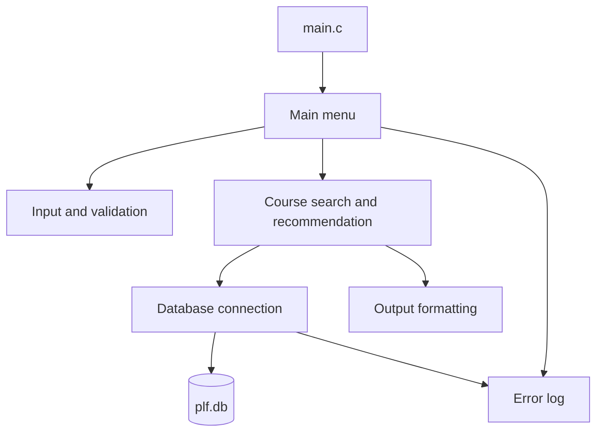

# **Personalized Learning Finder**
A C-based command-line application that recommends courses tailored to users' skills and passions, utilizing MySQL for database management. This tool assists users in choosing the best learning path to achieve their goals.

## Why we built it
There are many courses and every course has different rules. Age, education level and gender can be different. It is hard to check all of them by hand. So we built a simple tool that does the checking for the user.

## What the app can do
- Browse all courses, page by page
- Search courses by name
- Show full details of one course
- Recommend a course using the user's details
- Check the user input, and save errors to a log file

## Technologies
| Technology | Why we used it |
|---|---|
| C | Main programming language |
| SQLite | Small database stored in one file (`plf.db`) |
| SQL | Create tables, add data, and search courses |
| CMake | Build the project |
| CLion, Git and GitHub | Development and teamwork <!-- TODO: confirm --> |


## How the code is organised

We split the code into small parts. Each part has one job.



## Database

The database has 10 tables. The main table is `Courses`. Five small tables keep the extra data, like institution, category, currency, gender and education level. Two more tables connect courses with skills and passions, because one course can have many skills.
full diagram here:


---

## **How to Run the Application**

### **Requirements**
Ensure the following software is installed on your system:

1. **Git**
   - **Download:** [Git Official Site](https://git-scm.com/downloads)
   - **Verify Installation:**
     ```bash
     git --version
     ```

2. **MinGW** (Minimalist GNU for Windows)
   - **Download:** [MinGW-W64 Download](https://sourceforge.net/projects/mingw-w64/)
   - **Verify Installation:**
     ```bash
     gcc --version
     ```

3. **CMake**
   - **Download:** [CMake Windows x64 Installer](https://cmake.org/download/)
   - During installation, ensure to **add CMake to the system PATH**.
   - **Verify Installation:**
     ```bash
     cmake --version
     ```

4. **Visual Studio Code (VS Code)**
   - **Download:** [VS Code Official Site](https://code.visualstudio.com/download)
   - **Verify Installation:**
     ```bash
     code --version
     ```  
   - Install the **C/C++ Extension Pack** in VS Code:
      1. Open VS Code.
      2. Go to Extensions (`Ctrl+Shift+X`).
      3. Search for `C/C++ Extension Pack` and install it.

---

### **Steps to Run the Application**

1. **Clone the Repository**  
    - Open **Visual studio code** 
    - Close any existing projects by clicking on the `File` -> `Close Folder` option.
    - Now, click on `Explorer` -> `Clone Repository`
    - Enter this URL of the repository you want to clone and hit Enter:
   ```bash
   https://github.com/rukshan-prog/Personalized-Learning-Finder.git
   ```
    - It will ask you to select the location where you want to clone the repository
    - Simple select **desktop** and click on **Select as repository distinction** and then click **open**
    - It will take some time to clone the repository
    - Once the cloning is done, you will see a folder named **Personalized-Learning-Finder** in your desktop

2. **Run the Application**  
   - You can see the run button in the bottom middle of the screen
   - Click on the run button
   - It will build the project and run the application
   - That's it!
